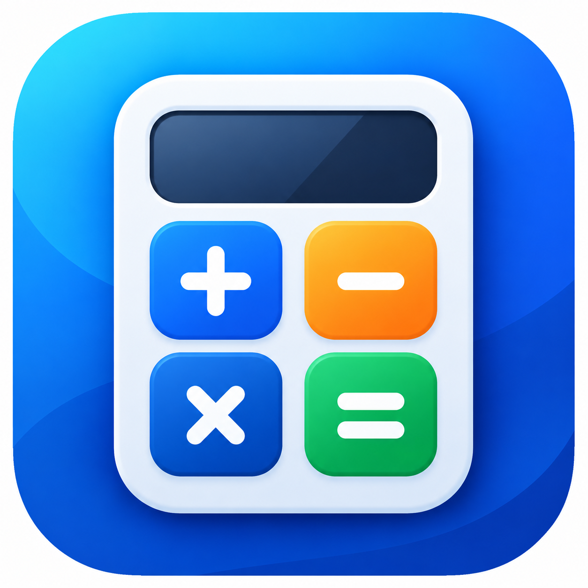
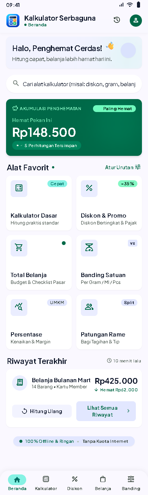
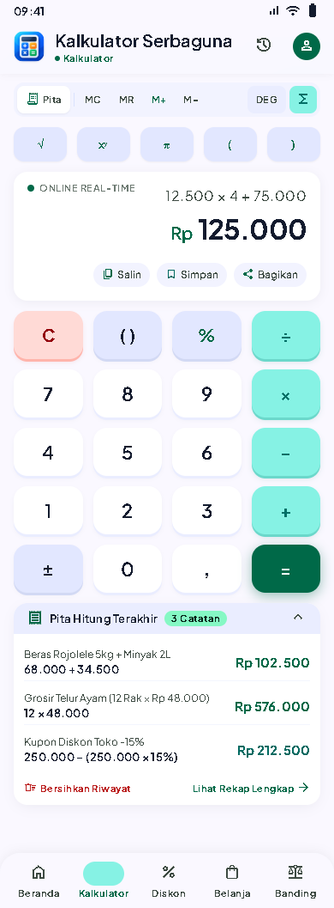
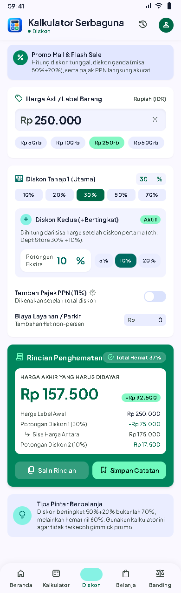
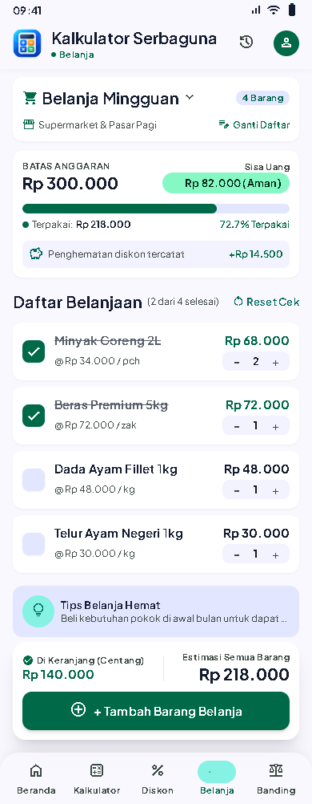
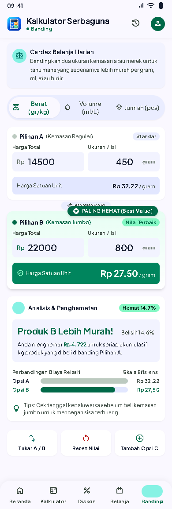

<div align="center">



# Kalkulator Serbaguna

**Aplikasi kalkulator Android offline untuk kebutuhan sehari-hari: kalkulator diskon, kalkulator persen, kalkulator belanja, perbandingan harga satuan, dan patungan (split bill).**

Dibuat dengan Flutter · Bahasa Indonesia · Tanpa akun · Tanpa internet


</div>

---

## Daftar Isi

- [Tentang Aplikasi](#tentang-aplikasi)
- [Fitur Lengkap](#fitur-lengkap)
- [Tampilan](#tampilan)
- [Cara Menjalankan](#cara-menjalankan)
- [Arsitektur](#arsitektur)
- [Ketepatan Perhitungan](#ketepatan-perhitungan)
- [Pengujian](#pengujian)
- [Build dan Rilis](#build-dan-rilis)
- [Privasi dan Data](#privasi-dan-data)
- [Status Proyek dan Roadmap](#status-proyek-dan-roadmap)
- [Pertanyaan Umum](#pertanyaan-umum)
- [Kontak dan Kredit](#kontak-dan-kredit)

---

## Tentang Aplikasi

**Kalkulator Serbaguna** adalah aplikasi kalkulator untuk Android yang dirancang untuk situasi nyata di Indonesia: membandingkan harga promo di mal, menghitung diskon bertingkat plus PPN, menjaga anggaran belanja ke pasar, memilih kemasan yang paling hemat, sampai membagi tagihan makan bersama teman.

Semua perhitungan berjalan **di perangkat Anda**, tanpa internet, tanpa akun, dan tanpa mengirim data ke server. Antarmuka berbahasa Indonesia dengan format Rupiah (`Rp 1.234.567`) yang bisa diganti ke format internasional.

> **Kata kunci:** kalkulator serbaguna, kalkulator diskon, kalkulator persen, kalkulator belanja, kalkulator harga satuan, kalkulator patungan, split bill, aplikasi kalkulator offline Android, aplikasi kalkulator Flutter open source.

### Kenapa Kalkulator Serbaguna?

| Kebutuhan | Yang Anda dapatkan |
|---|---|
| "Diskon 30% lalu tambah 10%, jadinya berapa?" | Diskon bertingkat dihitung dari sisa harga, plus PPN 11% dan biaya tambahan |
| "Belanja bulanan jangan sampai melebihi budget" | Daftar belanja dengan anggaran, sisa uang, dan centang barang |
| "Kemasan jumbo atau reguler yang lebih murah?" | Harga per gram, ml, atau pcs dibandingkan otomatis |
| "Patungan makan, bagi rata plus tip dan pajak" | Hasil per orang dengan pembulatan agar uang pas |
| "Angka di kalkulator HP kadang aneh (0,1 + 0,2)" | Perhitungan desimal presisi, bebas selisih floating point |

---

## Fitur Lengkap

### 1. Kalkulator Dasar
- Tambah, kurang, kali, bagi, persen, kurung, akar kuadrat (`√`), kuadrat (`x²`), dan `π`.
- Memori `MC`, `MR`, `M+`, `M−`.
- "Pita Hitung" yang memperlihatkan riwayat perhitungan; ketuk untuk memakainya lagi.
- Pembagian dengan nol ditolak dengan pesan yang jelas.

### 2. Kalkulator Diskon dan Promo
- Diskon tunggal atau **bertingkat** (misal 30% lalu tambah 10%).
- Pilihan cepat harga (Rp50rb, Rp100rb, Rp250rb, Rp500rb) dan diskon (10%, 20%, 30%, 50%, 70%).
- **PPN 11%** yang dikenakan setelah semua diskon, serta biaya layanan atau parkir.
- Rincian penghematan: potongan tiap tahap, total hemat, dan harga akhir.
- **Bandingkan Penawaran**: bandingkan dua promo dan lihat mana yang harga akhirnya paling murah.

### 3. Kalkulator Belanja dan Anggaran
- Daftar belanja dengan harga satuan, jumlah, dan diskon per barang.
- Batas anggaran, **sisa uang**, persentase terpakai, dan peringatan jika melebihi anggaran.
- Centang barang yang sudah masuk keranjang, dengan total terpisah antara "Di Keranjang" dan "Estimasi Semua Barang".
- Banyak daftar belanja (Belanja Mingguan, Belanja Bulanan, dan seterusnya).
- Tersimpan otomatis dan tetap ada setelah aplikasi ditutup.

### 4. Perbandingan Harga Satuan
- Bandingkan harga per **gram, ml, atau pcs** untuk dua kemasan atau lebih.
- Satuan berbeda (kg dan gram, liter dan ml) otomatis disamakan.
- Menunjukkan pilihan paling hemat, selisih harga, dan persentase hemat.

### 5. Kalkulator Persentase
Enam mode: persen dari nilai, berapa persen, kenaikan, penurunan, selisih, dan perubahan persen. Cocok untuk menghitung margin, kenaikan harga, atau markup. Setiap hasil menampilkan rumusnya.

### 6. Patungan Rame (Split Bill)
- Bagi tagihan ke 1 sampai 100 orang.
- Tip atau service dan pajak dengan pilihan cepat atau angka bebas.
- **Pembulatan ke atas** per orang (100, 500, 1.000) agar uang pas, dengan kelebihannya dihitung otomatis.
- Salin atau bagikan rincian ke grup chat.

### Fitur Pendukung
- **Riwayat**: simpan hasil, saring per jenis, hitung ulang, salin, bagikan.
- **Alat Favorit**: pilih dan urutkan alat di Beranda; tersimpan di perangkat.
- **Kartu "Hemat Pekan Ini"** yang menjumlahkan penghematan 7 hari terakhir.
- **Panduan Penggunaan** di dalam aplikasi, lengkap dengan pencarian dan tanya jawab.
- **Tema** Sistem, Terang, atau Gelap.
- **Format angka** Indonesia (`1.234,56`) atau Internasional (`1,234.56`) dan jumlah desimal yang bisa diatur.
- **Tentang dan Kredit** dengan tautan langsung ke WhatsApp, email, dan website pengembang.

---

## Tampilan

Desain antarmuka mengikuti mockup yang disimpan di folder [`mockup/`](mockup). Panduan visualnya ada di [`DESIGN.md`](mockup/kalkulator_cerdas_nusantara/DESIGN.md).

| Beranda | Kalkulator | Diskon |
|:---:|:---:|:---:|
|  |  |  |

| Belanja | Banding Harga Satuan |
|:---:|:---:|
|  |  |

> Gambar di atas adalah **mockup desain**. Tangkapan layar dari aplikasi yang berjalan akan ditambahkan setelah pengujian di perangkat.

---

## Cara Menjalankan

### Prasyarat
- [Flutter](https://docs.flutter.dev/get-started/install) (stable, diuji dengan 3.47) dan Dart 3.13 atau lebih baru
- Android Studio atau Android SDK dengan emulator atau perangkat Android

### Langkah

```bash
# 1. Klon repositori
git clone https://github.com/irvandoo/Aplikasi-Kalkulator-Serbaguna-Mobile-Flutter.git
cd Aplikasi-Kalkulator-Serbaguna-Mobile-Flutter

# 2. Pasang dependensi
flutter pub get

# 3. Jalankan di emulator atau perangkat Android
flutter run
```

### Pratinjau di Chrome (opsional)

```bash
flutter run -d chrome
```

Di web, database memakai `sqlite3.wasm` (`web/sqlite3.wasm` dan `web/sqflite_sw.js`). Iklan tidak aktif di web. Chrome hanya untuk pratinjau; pengujian akhir sebaiknya di Android.

---

## Arsitektur

Kode dipisah per lapisan agar logika hitung bisa diuji tanpa UI.

```
lib/
├── main.dart              # Titik masuk, inisialisasi database & pengaturan
├── app.dart               # Root widget, injeksi dependensi (Provider)
├── core/                  # Router, tema, format angka, widget bersama, nav bawah
├── domain/                # Logika hitung murni (tanpa Flutter): diskon, persen,
│                          #   belanja, harga satuan, patungan, evaluator ekspresi
├── data/                  # Model, SQLite (riwayat, belanja), SharedPreferences
├── infrastructure/        # Iklan (AdMob), salin/bagikan, pembuka tautan
└── features/              # Layar + ViewModel per fitur
    ├── home/  calculator/  discount/  shopping/  unit_price/
    ├── percentage/  split/  history/  tools/  guide/  settings/
```

| Aspek | Pilihan |
|---|---|
| State management | `provider` + `ChangeNotifier` (MVVM sederhana) |
| Navigasi | `go_router` dengan `StatefulShellRoute` untuk 5 tab |
| Penyimpanan lokal | `sqflite` (riwayat dan belanja), `shared_preferences` (pengaturan, favorit) |
| Angka | `decimal` untuk semua perhitungan uang dan persen |
| Berbagi | `share_plus`, `url_launcher` |
| Iklan | `google_mobile_ads` (hanya ID tes) |
| Dependency injection | Semua dependensi disuntik lewat konstruktor agar mudah dipalsukan di tes |

---

## Ketepatan Perhitungan

Semua uang dan persentase dihitung dengan tipe `Decimal`, **bukan** `double`. Dampaknya:

- `0,1 + 0,2` menghasilkan tepat `0,3`.
- Nilai antara tidak dibulatkan; pembulatan hanya pada hasil akhir (Rupiah utuh, setengah ke atas).
- Pembagian yang tidak habis dipotong di 12 digit, bukan dibulatkan diam-diam.

Aturan rumus tiap kalkulator didokumentasikan di komentar kode pada folder [`lib/domain/`](lib/domain).

---

## Pengujian

```bash
flutter analyze   # analisis statis
flutter test      # 181 tes: unit (domain), repositori, view model, dan widget
```

Cakupan: logika hitung, penyimpanan SQLite, view model, alur layar utama, konsistensi navigasi bawah pada semua layar, favorit, panduan, dan layar kredit.

Tes integrasi di perangkat (`integration_test`) **belum dibuat**.

---

## Build dan Rilis

```bash
# APK debug untuk uji coba
flutter build apk --debug

# Bundle rilis untuk Google Play (butuh keystore milik Anda)
flutter build appbundle --release
```

Sebelum rilis ke Google Play, hal berikut harus diisi oleh pemilik:

- [ ] ID aplikasi AdMob produksi (sekarang memakai **ID tes resmi Google**) di `AndroidManifest.xml` dan `lib/infrastructure/ad_service.dart`
- [ ] Keystore dan konfigurasi penandatanganan rilis
- [ ] Package ID final (sekarang `com.kalkulatorserbaguna.kalkulatorserbaguna`)
- [ ] URL kebijakan privasi publik (draf ada di `assets/legal/kebijakan_privasi.txt`)
- [ ] Deklarasi Data safety dan iklan di Play Console

---

## Privasi dan Data

- Riwayat, daftar belanja, dan pengaturan **hanya disimpan di perangkat**.
- Tidak ada akun, tidak ada server, dan tidak ada analitik.
- Tidak meminta izin sensitif (lokasi, kontak, kamera, dan sebagainya).
- Iklan memakai Google AdMob dengan formulir persetujuan Google UMP di wilayah yang mewajibkan. Selama pengembangan hanya ID iklan tes yang dipakai.

Draf lengkap: [`assets/legal/kebijakan_privasi.txt`](assets/legal/kebijakan_privasi.txt).

---

## Status Proyek dan Roadmap

**Status:** pengembangan aktif. Semua fitur di atas sudah berfungsi dan lolos tes otomatis. Aplikasi **belum dipublikasikan di Google Play**, dan build di perangkat Android nyata masih dalam tahap verifikasi.

**Berikutnya**
- [ ] Verifikasi build dan uji di emulator serta perangkat Android
- [ ] Tes integrasi (alur lengkap dan persistensi setelah restart)
- [ ] Tangkapan layar aplikasi asli
- [ ] Konfigurasi AdMob produksi dan rilis ke Google Play

**Ide ke depan:** konverter satuan (panjang, luas, suhu), kalkulator rasio dan rata-rata, simulasi cicilan, tujuan tabungan, dan ekspor laporan.

---

## Pertanyaan Umum

**Apakah Kalkulator Serbaguna gratis dan perlu internet?**
Tidak perlu internet. Semua perhitungan berjalan offline. Internet hanya dipakai jika iklan dimuat atau Anda membuka tautan kontak.

**Bagaimana cara menghitung diskon bertingkat, misalnya 30% + 10%?**
Pakai alat *Diskon & Promo*, isi harga asli, lalu tambahkan tahap diskon kedua. Diskon kedua dihitung dari harga setelah diskon pertama, jadi hasilnya bukan 40%, melainkan 37%.

**Bagaimana cara membandingkan harga satuan dua kemasan?**
Pakai alat *Banding Satuan*, isi harga total dan isi tiap kemasan. Aplikasi menghitung harga per gram, ml, atau pcs dan menandai yang paling hemat.

**Apakah data belanja saya aman?**
Data disimpan hanya di perangkat Anda dan tidak dikirim ke server mana pun.

**Bisakah saya memakai kodenya?**
Repositori ini publik untuk dibaca dan dipelajari. Lisensi belum ditentukan, jadi hubungi pemilik sebelum memakai ulang kodenya untuk proyek lain.

---

## Kontak dan Kredit

Dikembangkan oleh **Irvando Demas Arifiandani**.

| | |
|---|---|
| WhatsApp | [0857-4747-6308](https://wa.me/6285747476308) |
| Email | irvando.d.a@gmai.com |
| Website | [irvandoda.web.id](https://irvandoda.web.id) |

Saran, laporan masalah, atau ide fitur bisa lewat [GitHub Issues](https://github.com/irvandoo/Aplikasi-Kalkulator-Serbaguna-Mobile-Flutter/issues) atau kontak di atas.

---

<div align="center">

Jika proyek ini bermanfaat, beri bintang ⭐ di GitHub.

</div>
